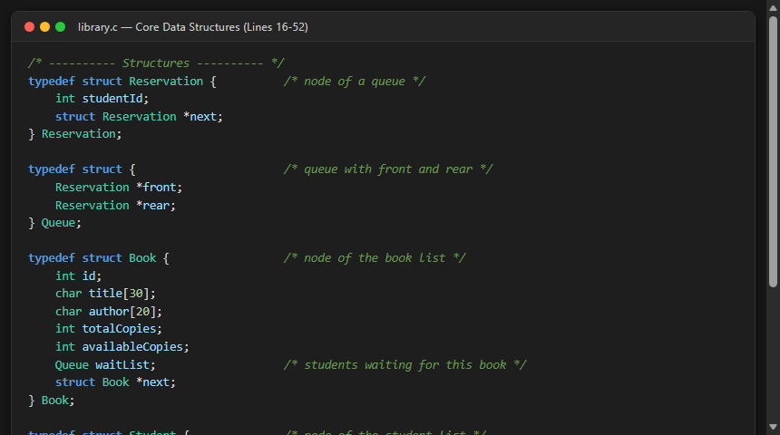
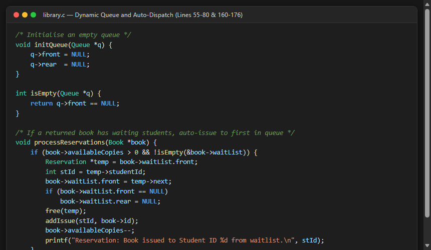
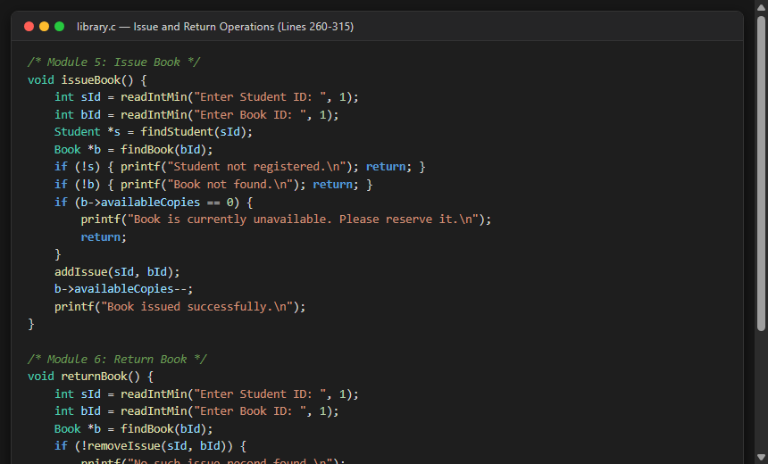
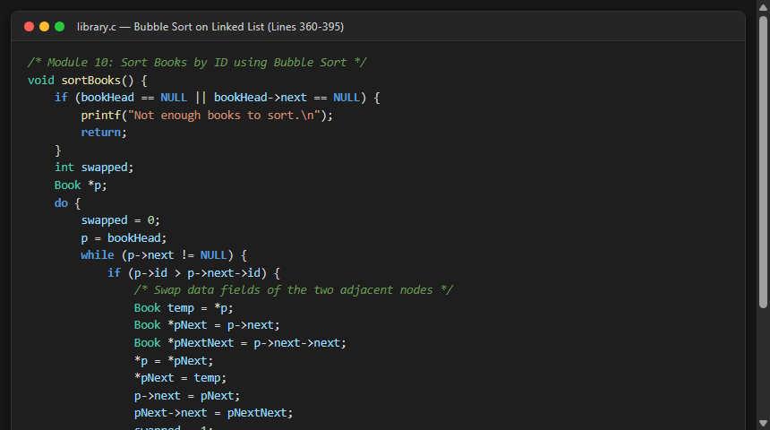

# Smart Library Management System Using Data Structures in C

A modular, console-based library automation system written in standard C, demonstrating practical implementations of fundamental Data Structures and Algorithms (DSA) including Singly Linked Lists, First-In-First-Out (FIFO) Queues, Linear Search, and Bubble Sort.

Developed by **Palak Rathore**, **Niharika**, and **Saransh** for the **Data Structures (Semester III, IT Evening)** coursework at **Maharaja Surajmal Institute of Technology (MSIT)**, affiliated with **Guru Gobind Singh Indraprastha University (GGSIPU)**, under the guidance of **Dr. Sunesh Malik**.

---

## Academic Information

- **Institute**: Maharaja Surajmal Institute of Technology, C-4 Janak Puri, New Delhi-110058
- **Subject**: Data Structures (ETIT-205)
- **Course**: B.Tech Information Technology, Semester III (IT Evening)
- **Academic Session**: 2025–2029
- **Project Guide**: Dr. Sunesh Malik, Department of Information Technology
- **Project Team**:
  - **Palak Rathore** — Enrollment No.: `04196303125`
  - **Niharika** — Enrollment No.: `01996303125`
  - **Saransh** — Enrollment No.: `04796303125`

---

## Core Data Structures & Concepts Implemented

### 1. Singly Linked Lists (`malloc()` / `free()`)
- Dynamic heap allocation for Book catalog, Registered Students, and Active Loan transactions.
- Eliminates fixed array capacity boundaries; consumes memory only when records exist.
- Clean traversal and unlinking routines with complete heap deallocation via `freeAll()` at exit.

<p align="center">
  
</p>

### 2. Fair FIFO Reservation Engine (Queue per Book)
- Each `Book` node encapsulates its own independent `Queue` structure with `front` and `rear` pointers.
- Guarantees $O(1)$ Enqueue and Dequeue operations.
- **Automated Waitlist Dispatch (`processReservations`)**: When an issued book is returned, the system automatically checks that book's waiting queue, dequeues the student who requested it first, and re-issues the copy immediately.

<p align="center">
  
</p>

### 3. Circulation Management (Issue & Return)
- Validates student registration and book availability before issuing.
- Decrements and increments availability counters in synchronized balance.

<p align="center">
  
</p>

### 4. In-Place Bubble Sort on Linked Nodes
- Orders the book catalog in ascending order of Book ID.
- Swaps node data in-place while keeping pointer connections intact, complete with early-termination flag (`swapped`).

<p align="center">
  
</p>

---

## Project Structure

```text
smart-library-management-system/
├── library.c              # Complete C source implementation (~430 lines)
├── Makefile               # Cross-platform build script
├── build.bat              # Windows compilation & run script
├── screenshots/           # Code implementation snapshots
│   ├── screenshot_structures.png
│   ├── screenshot_queue_dispatch.png
│   ├── screenshot_issue_return.png
│   └── screenshot_bubble_sort.png
├── .gitignore             # Ignored compilation binaries & swap files
└── README.md              # Project documentation
```

---

## Build & Execution Instructions

### Prerequisites
- GCC / Clang / MinGW C compiler (supporting C99 or later).
- Standard C headers: `<stdio.h>`, `<stdlib.h>`, `<string.h>`.

### Compilation via GCC
```bash
# Standard compilation
gcc library.c -o library

# Academic warning-free compilation
gcc -Wall -Wextra -std=c99 -pedantic library.c -o library
```

### Running the System
- **Linux / macOS**:
  ```bash
  ./library
  ```
- **Windows (Command Prompt / PowerShell)**:
  ```powershell
  .\library.exe
  ```
- **Using Makefile**:
  ```bash
  make run
  ```

---

## Menu Options

```text
==========================================
     SMART LIBRARY MANAGEMENT SYSTEM
==========================================
 1. Add Book
 2. Display All Books
 3. Search Book
 4. Add Student
 5. Issue Book
 6. Return Book
 7. Reserve Book
 8. View Waiting List
 9. View Issued Books
10. Sort Books by ID
 0. Exit
------------------------------------------
```

---

## Complexity Matrix

| Operation | Data Structure / Algorithm | Best Case | Average Case | Worst Case | Space |
| :--- | :--- | :---: | :---: | :---: | :---: |
| **Insert Book / Student** | Linked List Append | $O(1)$ | $O(n)$ | $O(n)$ | $O(1)$ |
| **Search by Book ID** | Linear Search | $O(1)$ | $O(n)$ | $O(n)$ | $O(1)$ |
| **Search by Title** | Substring Linear Scan | $O(n)$ | $O(n)$ | $O(n)$ | $O(1)$ |
| **Sort Books by ID** | In-Place Bubble Sort | $O(n)$ | $O(n^2)$ | $O(n^2)$ | $O(1)$ |
| **Reserve Book** | FIFO Queue Enqueue | $O(1)$ | $O(1)$ | $O(1)$ | $O(1)$ |
| **Auto-Issue on Return**| FIFO Queue Dequeue | $O(1)$ | $O(1)$ | $O(1)$ | $O(1)$ |
| **Issue / Return Book** | Search + Link Manipulation | $O(1)$ | $O(n)$ | $O(n)$ | $O(1)$ |

---

## License & Academic Attribution
Developed for educational evaluation under Guru Gobind Singh Indraprastha University. Free for reference with academic attribution.
